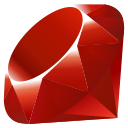
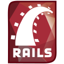
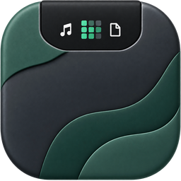
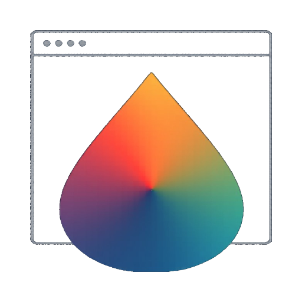

# 👋 Hi, I'm Tudor, 20 year old from Romania!

I build small tools for things I run into myself, then try to make them useful enough for other people to use too.

My stack:  <strong>Python</strong> &nbsp;  <strong>JavaScript</strong> &nbsp;  <strong>C#</strong> &nbsp;  <strong>.NET</strong> &nbsp;  <strong>Ruby</strong> &nbsp;  <strong>Rails</strong>

I’m also learning more about machine learning and agent workflows. Some projects here are products, and others are smaller exercises where I work through a concept.

## What I’m building

### [BuildNotch](https://www.buildnotch.app/)

A Windows notch with tools I use while coding and focusing: project shortcuts, GitHub activity, AI usage, notes, timers, and clipboard utilities. It’s one of the first products I’ve put out as a paid app.

### [UIDrop](https://uidrop.site/)

A Chrome extension for collecting design systems and components from websites and preparing them as references for AI-assisted frontend work.

### [ClaimTheBill](https://github.com/tudorp06/claimthebill)

A Rails app for splitting a receipt with friends. Upload a receipt, check the extracted items, and share a link so everyone can claim what they ordered. Participants can see each other’s cursors on the bill.

This project refreshed my Ruby and Rails knowledge, especially Active Record, Action Controller, Active Storage, external API calls, and real-time updates with Action Cable. The project README explains the implementation and setup.

## Smaller projects and practice

I collect my [roadmap.sh implementations](https://github.com/tudorp06/roadmap-projects) in one repository, with a folder for each project and notes on what I practiced. So far that includes a pencil-style unit converter, two GitHub CLIs, a task tracker, and a URL shortener.

I keep those separate from the products above: they’re a place to learn, make mistakes, and revisit the basics by building something.
